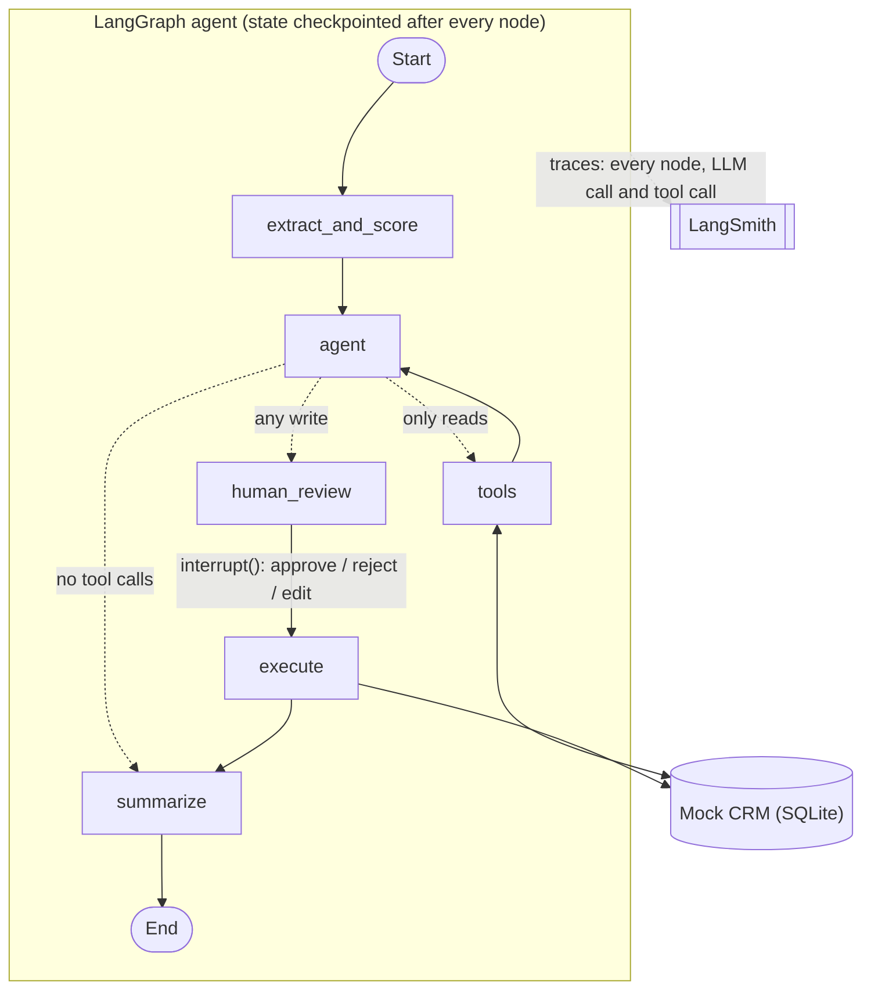

# Switchboard

**Model-agnostic LangGraph agent stack: swap LLMs in one line, tools over MCP, human approval, evals and tracing built in.**

A switchboard routes connections. Here it routes any model to any tool, with a human operator approving every action that changes data.

The demo use case is **inbound lead qualification against a mock CRM**: an agent reads a sales lead, checks the facts with CRM and enrichment tools, proposes CRM changes, and waits for a human to approve, reject or edit them before anything is written.

> **Status:** work in progress. The agent, tools, provider switching, human-in-the-loop, LangSmith tracing and the eval harness work ([results](#eval-results)).
> MCP, the REST API, Docker and CI are next (see [Roadmap](#roadmap)).

---

## What it does

Given a lead like:

> *Hello, Ada Park here, Head of Operations at Initech (ada@initech.example). Just exploring options for next year, no rush.*

the agent:

1. **Extracts and scores** the lead into a typed `LeadScore` (name, email, company, fit score 0-100, intent, reasons), using structured output.
2. **Checks the facts** with read-only tools: `lookup_company` (CRM data or mock enrichment) and `search_contacts`.
3. **Plans CRM writes** following explicit rules: create a new contact plus a follow-up task, update an existing contact, or change nothing.
4. **Pauses for human review.** Nothing is written until a person approves, rejects or edits the plan.
5. **Executes** the approved writes in order and **summarizes** what happened for the sales team.

A real run, from the terminal demo (output shortened):

```text
--> extract_and_score
--> agent
    calls lookup_company({'domain': 'initech.example'})
    calls search_contacts({'query': 'ada@initech.example'})
--> tools
    result {"found": true, "source": "enrichment", "name": "Initech", "industry": "Software", "employee_count": 300}
    result {"count": 0, "contacts": []}
--> agent
    calls create_contact({'name': 'Ada Park', 'email': 'ada@initech.example', 'title': 'Head of Operations', ...})
    calls create_task({'contact_email': 'ada@initech.example', 'description': 'Follow up with Ada Park ...'})

  PLANNED CRM WRITES (nothing has been written yet):
    1. create_contact {"name": "Ada Park", "email": "ada@initech.example", ...}
    2. create_task {"contact_email": "ada@initech.example", ...}
  [a]pprove / [r]eject / [e]dit? a
--> human_review
--> execute
    result {"created": {"id": 5, "name": "Ada Park", ..., "company": "Initech"}}
    result {"created_task": {"id": 2, "contact": "ada@initech.example", ...}}
--> summarize
```

---

## Architecture



| Node | What it does |
|---|---|
| `extract_and_score` | Structured output into `LeadScore`, with one retry on invalid output. Treated as a *first impression*, not a decision. |
| `agent` | LLM with all CRM tools bound. Loops with `tools` until it has the facts it needs. |
| `tools` | LangGraph `ToolNode`. Runs **read-only** tools immediately. |
| `human_review` | `interrupt()` shows the planned writes; the run resumes with `approve`, `reject` or `edit`. |
| `execute` | Runs the approved writes **one by one, in order**, and reports errors back as messages. |
| `summarize` | 2-4 sentence summary for the sales team, given the confirmed CRM changes as facts. |

State is a typed `LeadState` (`TypedDict`). `messages` uses the `add_messages` reducer, and a checkpointer saves the state after every node, which is what makes pausing and resuming possible.

Reads hit the CRM directly through `tools`; writes reach it only through `execute`, after review. When LangSmith is configured, every run is traced automatically, with no tracing code in the graph (see [Tracing](#tracing-langsmith)).

### Generic core, pluggable use cases

```
src/switchboard/
├─ core/                         reusable, no provider- or use-case-specific code
│  ├─ llm.py                     get_llm("provider:model")
│  └─ structured.py              structured output with retry and clean failure
└─ usecases/lead_qualification/  the demo use case
   ├─ db.py                      SQLAlchemy models + seed data for the mock CRM
   ├─ tools.py                   5 CRM tools, built by make_tools(engine)
   ├─ state.py                   LeadScore (Pydantic) and LeadState (graph state)
   ├─ prompts.py                 scoring, agent and summary prompts
   ├─ scoring.py                 lead -> LeadScore
   ├─ graph.py                   the StateGraph
   └─ cli.py                     terminal demo with human approval
```

The rule: **`core/` never imports from a use case.** A second use case adds its own folder (state, tools, prompts, graph) and reuses the core.

---

## Quickstart

Requirements: Python 3.11+ and [uv](https://docs.astral.sh/uv/).

```bash
git clone https://github.com/baksh07/switchboard-agents.git
cd switchboard-agents
uv sync
cp .env.example .env        # then add OPENAI_API_KEY and/or GROQ_API_KEY
```

Run the tests (no API keys needed, the LLM is faked):

```bash
uv run pytest
```

Run the agent on three sample leads, with you as the approver:

```bash
uv run python -m switchboard.usecases.lead_qualification.cli --model openai:gpt-4o-mini
```

Other options:

```bash
# your own lead
uv run python -m switchboard.usecases.lead_qualification.cli --lead "Hi, I'm ..."

# approve every plan automatically
uv run python -m switchboard.usecases.lead_qualification.cli --auto-approve

# print the graph as a Mermaid diagram
uv run python -m switchboard.usecases.lead_qualification.cli --mermaid
```

The mock CRM lives in `crm.db` (SQLite) and is created and seeded on first run. Delete the file to reset it.

### Reviewing a plan

When the agent plans CRM writes, the run pauses:

| Input | Effect |
|---|---|
| `a` | approve: run the plan as proposed |
| `r` | reject: write nothing; the summary says a reviewer rejected it |
| `e` | edit: for each planned call, press Enter to keep it, type `drop` to remove it, or paste new JSON arguments |

---

## Switching models

Every model is chosen with one `provider:model` string, from `--model` or `MODEL` in `.env`:

```python
from switchboard.core.llm import get_llm

llm = get_llm("openai:gpt-4o-mini")
llm = get_llm("groq:openai/gpt-oss-120b")
```

`get_llm` wraps LangChain's `init_chat_model`, so the graph only ever sees a `BaseChatModel` and no provider-specific code. It defaults to `temperature=0` and `max_retries=6` (agent runs make several calls and easily hit free-tier rate limits).

Tested so far: OpenAI `gpt-4o-mini` and Groq `openai/gpt-oss-120b`. Adding a provider means installing its LangChain package (e.g. `uv add langchain-anthropic`); no code changes.

---

## Tracing (LangSmith)

Every run can be traced in [LangSmith](https://smith.langchain.com): each node, LLM call and tool call, with the exact prompts, outputs, latency and tokens. No tracing code is needed; LangChain and LangGraph pick it up from environment variables. Add to `.env`:

```bash
LANGSMITH_TRACING=true
LANGSMITH_API_KEY=lsv2_...
LANGSMITH_PROJECT=switchboard
```

> **Gotcha:** `LANGSMITH_TRACING` must be lowercase `true`. LangSmith compares the value with `== "true"`, so `True` or `1` silently turns tracing off: the agent runs normally, but no traces appear and no error is shown.
> To check your key works: `uv run python -c "from dotenv import load_dotenv; load_dotenv(); from langsmith import Client; print([p.name for p in Client().list_projects()])"`

Runs are named `lead_qualification` and tagged `cli`. A lead that pauses for human review produces **two traces**: one up to `interrupt()`, and one from the `Command(resume=...)` to the end. Both carry the same `thread_id` in their metadata, so LangSmith's **Threads** view shows them together.

---

## Eval results

The eval harness (`core/evals.py`) runs every lead in [`evals/datasets/lead_qualification.jsonl`](evals/datasets/lead_qualification.jsonl) through the full agent on a fresh seeded CRM, auto-approves the plan, and grades the **planned CRM writes** against the expected answer.

```bash
uv run python -m switchboard.core.evals --models openai:gpt-4o-mini groq:openai/gpt-oss-120b --out evals/results/baseline.jsonl
```

**Baseline, 2026-10-29, n = 12 leads, one run per model** (raw rows: [`evals/results/baseline.jsonl`](evals/results/baseline.jsonl)):

| model | action correct | full plan correct | errors | median latency / lead | avg tokens in / out | cost / lead |
|---|---|---|---|---|---|---|
| `openai:gpt-4o-mini` | 92% (11/12) | 83% (10/12) | 0 | 6.0 s | 2,649 / 258 | $0.00055 |
| `groq:openai/gpt-oss-120b` | **100% (12/12)** | 42% (5/12) | 0 | 20.2 s* | 3,480 / 1,211 | $0.00125 |

- **action correct:** chose the right path: create, update, disqualify, or change nothing.
- **full plan correct:** right path *and* a follow-up task exactly when one is expected.
- Cost uses list prices checked on 2026-10-29: both models cost $0.15 / $0.60 per 1M input / output tokens.

**What the numbers say**

- **gpt-oss-120b made the right decision every time, but never created a follow-up task.** It makes one tool call per turn (update the contact, *then* add the task), while this graph gives the agent a single write turn per lead. The low full-plan score is therefore mostly a **design limitation of this graph**, surfaced by the eval, not only a model weakness. Fixing it and re-measuring is the next step.
- **gpt-4o-mini plans both writes in one turn**, so it scores higher on full plans. But it made the only wrong decision: it created a 12-employee company as a lead after `lookup_company` had returned the size, which the rules exclude. It also dropped the task once (`mei_existing_fit`).
- **Same price per token, 2.3× the cost per lead:** gpt-oss is a reasoning model. It produced about 4.7× more output tokens (hidden reasoning is billed as output), and its one-call-per-turn style means more agent turns, each re-sending the conversation.
- \* **The Groq latency mostly measures the free tier's rate limit**, not the model. One lead uses about 4,000-5,000 tokens and the free tier allows 8,000 tokens per minute, so after the first two leads (6.2 s and 3.6 s) every lead waited for retries. Don't read this as "Groq is slower"; single unthrottled calls were faster on Groq in manual tests.
- With 12 leads, one flipped case moves a score by 8 points, and repeated runs differed by about that much. Only large gaps (like 100% vs 42%) are meaningful.

---

## Design decisions

Most of these came from bugs found while running the agent against real models.

**Reads run freely, writes need approval, and the graph enforces it.**
The LLM can request any tool, but `route_after_agent` (plain Python, unit-tested) sends any turn containing a write tool to `human_review`. Safety does not depend on the model following the prompt.

**Writes run in order in their own node.**
`ToolNode` runs tool calls in parallel. In an early version, `create_task` ran before `create_contact` had finished, failed with "no such contact", and the agent's recovery attempts created a duplicate task. `execute` now runs writes sequentially.

**The first-pass score is a hint; the decision comes after the tools.**
Scoring the raw email alone made one model claim *"company size fits"* when the email never mentioned size. Now the score is labelled unverified, and the agent decides only after `lookup_company`.

**If code can check a fact, code tells the model.**
The summary model once reported a contact as created when nothing had been written, and once invented a reason for a rejected plan. `summarize` now passes the confirmed writes (or "a reviewer rejected the plan") as explicit facts.

**Tools return errors as data.**
`{"error": "Contact already exists. Use update_contact."}` lets the agent correct itself instead of crashing the run. Inputs are validated by type hints (e.g. `status: Literal["new", "qualified", "disqualified"]`), emails are normalized, and the database enforces unique emails as a final guard.

**Tools are built by a factory: `make_tools(engine)`.**
No global database: the CLI passes `crm.db`, tests pass a temporary SQLite file. The same idea (passing dependencies in) is used for the LLM in `build_graph(llm, tools)`, which is why the whole graph can be tested with a scripted fake model.

**Editing a plan replaces the agent's message.**
An edited plan is a new `AIMessage` with the *same id*, so `add_messages` replaces the original and `execute` needs no special case for edits.

**Structured output retries once, showing the model its error, then fails cleanly** with a dedicated `StructuredOutputError`.

---

## Testing

```bash
uv run pytest
```

- **Tools:** every tool's success and error paths against a temporary SQLite database.
- **LLM factory:** provider selection, defaults and input validation (no network calls).
- **Structured output:** first-try success, retry with the error shown to the model, clean failure.
- **Graph:** routing rules, plus full runs with a scripted fake LLM: the graph pauses *before* any write, and approve, reject and edit each produce the right CRM state.
- **Eval harness:** scoring, error handling and the cost/latency maths, using a fake use case (proves the harness has no lead-specific code).

No API keys are needed to run the tests. The evals (above) call real models and are run separately.

---

## Roadmap

- [x] LangGraph agent with typed state, conditional routing and a checkpointer
- [x] Model-agnostic LLM layer (OpenAI and Groq tested)
- [x] CRM tools with unit tests (SQLAlchemy, SQLite)
- [x] Structured output with retry
- [x] Human-in-the-loop approval with `interrupt()` (approve / reject / edit)
- [x] LangSmith tracing
- [x] Eval harness: accuracy, latency, tokens and cost per model, with a results table
- [ ] Let the agent make follow-up writes after the first approved plan, then re-run the evals
- [ ] MCP server for the CRM tools (`--tools mcp|local`)
- [ ] FastAPI: start runs, approve via HTTP, webhook receiver
- [ ] Docker Compose
- [ ] GitHub Actions CI (lint + tests)
- [ ] Optional: RAG knowledge-base tool, Amazon Bedrock provider

## Limitations

- The CRM and the company enrichment are mocks with fake `.example` data.
- The checkpointer is in-memory, so a paused run is lost when the process exits. A persistent checkpointer comes with the API.
- The agent gets one write plan per lead. If a model proposes only part of its plan (for example, an update without the follow-up task), the rest is not executed. The evals show this costs gpt-oss-120b most of its full-plan score.
- The eval set is small (12 leads) and each model was run once, so results carry noticeable run-to-run variation.
- Groq results were measured on the free tier, whose rate limit inflates latency.
