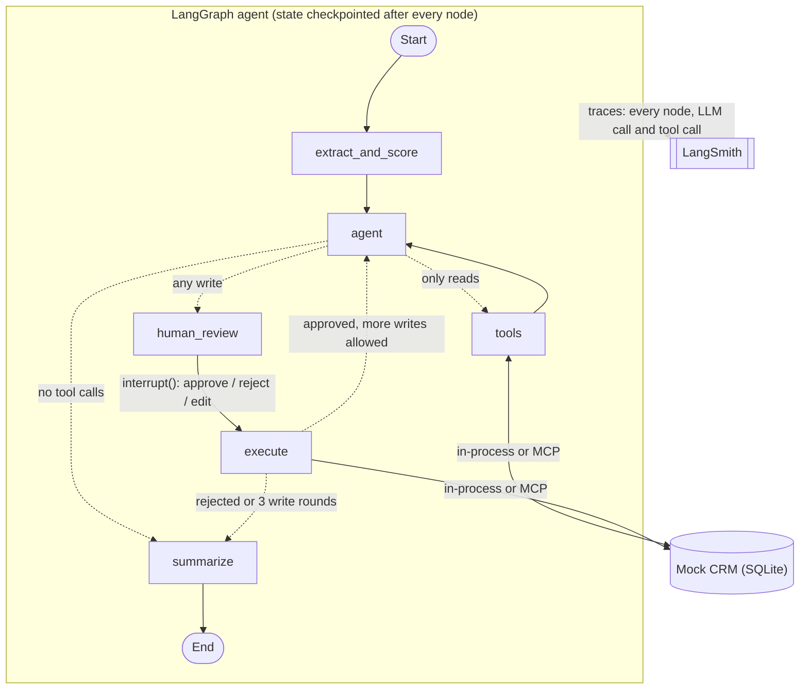
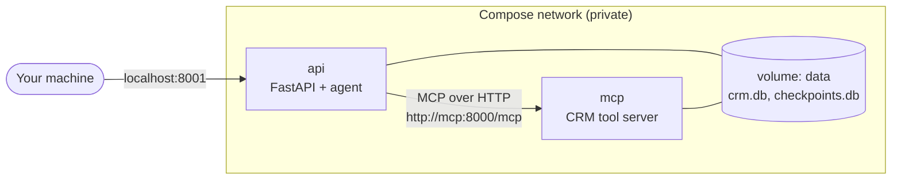

# Switchboard

[](https://github.com/baksh07/switchboard-agents/actions/workflows/ci.yml)

**Model-agnostic LangGraph agent stack: swap LLMs in one line, tools over MCP, human approval, evals and tracing built in.**

A switchboard routes connections. Here it routes any model to any tool, with a human operator approving every action that changes data.

The demo use case is **inbound lead qualification against a mock CRM**: an agent reads a sales lead, checks the facts with CRM and enrichment tools, proposes CRM changes, and waits for a human to approve, reject or edit them before anything is written.

> **Status:** the core is complete: the agent, tools, provider switching, human-in-the-loop, LangSmith tracing, the eval harness ([results](#eval-results)), the MCP server, the REST API with webhooks, Docker Compose and CI.
> Open items are in the [Roadmap](#roadmap) and [Limitations](#limitations).

**How it was built:** step by step with Claude Code as a coach. It explained and drafted each component; I typed, ran and debugged the code myself. The README and a few small fixes were edited by Claude Code at my request.

---

## What it does

Given a lead like:

> *Hello, Ada Park here, Head of Operations at Initech (ada@initech.example). Just exploring options for next year, no rush.*

the agent:

1. **Extracts and scores** the lead into a typed `LeadScore` (name, email, company, fit score 0-100, intent, reasons), using structured output.
2. **Checks the facts** with read-only tools: `lookup_company` (CRM data or mock enrichment) and `search_contacts`.
3. **Plans CRM writes** following explicit rules: create a new contact plus a follow-up task, update an existing contact, or change nothing.
4. **Pauses for human review.** Nothing is written until a person approves, rejects or edits the plan.
5. **Executes** the approved writes in order and **summarizes** what happened for the sales team.

A real run, from the terminal demo (output shortened):

```text
--> extract_and_score
--> agent
    calls lookup_company({'domain': 'initech.example'})
    calls search_contacts({'query': 'ada@initech.example'})
--> tools
    result {"found": true, "source": "enrichment", "name": "Initech", "industry": "Software", "employee_count": 300}
    result {"count": 0, "contacts": []}
--> agent
    calls create_contact({'name': 'Ada Park', 'email': 'ada@initech.example', 'title': 'Head of Operations', ...})
    calls create_task({'contact_email': 'ada@initech.example', 'description': 'Follow up with Ada Park ...'})

  PLANNED CRM WRITES (nothing has been written yet):
    1. create_contact {"name": "Ada Park", "email": "ada@initech.example", ...}
    2. create_task {"contact_email": "ada@initech.example", ...}
  [a]pprove / [r]eject / [e]dit? a
--> human_review
--> execute
    result {"created": {"id": 5, "name": "Ada Park", ..., "company": "Initech"}}
    result {"created_task": {"id": 2, "contact": "ada@initech.example", ...}}
--> summarize
```

---

## Architecture



| Node | What it does |
|---|---|
| `extract_and_score` | Structured output into `LeadScore`, with one retry on invalid output. Treated as a *first impression*, not a decision. |
| `agent` | LLM with all CRM tools bound. Loops with `tools` until it has the facts it needs. |
| `tools` | LangGraph `ToolNode`. Runs **read-only** tools immediately. |
| `human_review` | `interrupt()` shows the planned writes; the run resumes with `approve`, `reject` or `edit`. |
| `execute` | Runs the approved writes **one by one, in order**, and reports errors back as messages. |
| `summarize` | 2-4 sentence summary for the sales team, given the confirmed CRM changes as facts. |

State is a typed `LeadState` (`TypedDict`). `messages` uses the `add_messages` reducer, and a checkpointer saves the state after every node, which is what makes pausing and resuming possible.

Reads hit the CRM directly through `tools`; writes reach it only through `execute`, after review. When LangSmith is configured, every run is traced automatically, with no tracing code in the graph (see [Tracing](#tracing-langsmith)).

### Generic core, pluggable use cases

```
mcp_server/
└─ crm_server.py                 the 5 CRM tools as an MCP server (stdio or HTTP)
src/switchboard/
├─ core/                         reusable, no provider- or use-case-specific code
│  ├─ llm.py                     get_llm("provider:model")
│  ├─ structured.py              structured output with retry and clean failure
│  ├─ mcp.py                     load tools from any MCP server as normal LangChain tools
│  └─ evals.py                   generic eval harness (accuracy, latency, tokens, cost)
└─ usecases/lead_qualification/  the demo use case
   ├─ db.py                      SQLAlchemy models + seed data for the mock CRM
   ├─ tools.py                   5 CRM tools: make_tools(engine), load_tools(engine, "local"|"mcp"|"mcp-http")
   ├─ state.py                   LeadScore (Pydantic) and LeadState (graph state)
   ├─ prompts.py                 scoring, agent and summary prompts
   ├─ scoring.py                 lead -> LeadScore
   ├─ graph.py                   the StateGraph
   ├─ cli.py                     terminal demo with human approval
   └─ api.py                     FastAPI: runs, review decisions, signed webhook
```

The rule: **`core/` never imports from a use case.** A second use case adds its own folder (state, tools, prompts, graph) and reuses the core.

---

## Quickstart

Requirements: Python 3.11+ and [uv](https://docs.astral.sh/uv/). Or only Docker: see [Running with Docker](#running-with-docker).

```bash
git clone https://github.com/baksh07/switchboard-agents.git
cd switchboard-agents
uv sync
cp .env.example .env        # then add OPENAI_API_KEY and/or GROQ_API_KEY
```

Run the tests (no API keys needed, the LLM is faked):

```bash
uv run pytest
```

Run the agent on three sample leads, with you as the approver:

```bash
uv run python -m switchboard.usecases.lead_qualification.cli --model openai:gpt-4o-mini
```

Other options:

```bash
# your own lead
uv run python -m switchboard.usecases.lead_qualification.cli --lead "Hi, I'm ..."

# approve every plan automatically
uv run python -m switchboard.usecases.lead_qualification.cli --auto-approve

# print the graph as a Mermaid diagram
uv run python -m switchboard.usecases.lead_qualification.cli --mermaid

# call the CRM tools through the MCP server instead of in-process (see MCP below)
uv run python -m switchboard.usecases.lead_qualification.cli --tools mcp
```

The mock CRM lives in `crm.db` (SQLite) and is created and seeded on first run. Delete the file to reset it.

### Reviewing a plan

When the agent plans CRM writes, the run pauses:

| Input | Effect |
|---|---|
| `a` | approve: run the plan as proposed |
| `r` | reject: write nothing; the summary says a reviewer rejected it |
| `e` | edit: for each planned call, press Enter to keep it, type `drop` to remove it, or paste new JSON arguments |

---

## REST API

The same agent over HTTP (FastAPI). A run pauses at review **between two requests**: one starts it, another approves it, minutes or days later.

```bash
uv run uvicorn switchboard.usecases.lead_qualification.api:app
```

Interactive docs: http://127.0.0.1:8000/docs. Settings come from `.env`: `MODEL`, `TOOLS` (`local`, `mcp` or `mcp-http`), `CHECKPOINT_DB` (default `checkpoints.db`) and `WEBHOOK_SECRET`.

| Endpoint | What it does |
|---|---|
| `POST /runs` `{"lead_text": "..."}` | Runs the agent until it needs a review (or finishes). Returns `thread_id`, `status`, `score`, `planned_writes`. |
| `GET /runs/{thread_id}` | Current status: `running`, `awaiting_review` or `completed` (with `summary`). |
| `POST /runs/{thread_id}/decision` | `{"action": "approve"}`, `{"action": "reject"}` or `{"action": "edit", "tool_calls": [...]}`. Resumes the run. |
| `POST /webhooks/lead` | For a form or CRM to push leads (below). |
| `GET /health` | Liveness check. |

Errors: `404` unknown run, `409` the run is not waiting for a review (e.g. a second approval of the same plan), `422` invalid body.

**Paused runs survive restarts.** The API saves checkpoints to SQLite (`SqliteSaver`), in a file separate from the CRM data: agent state and business data have different lifecycles. A test starts a run, shuts the app down, builds a new one on the same file and approves the run there.

### Webhook

`POST /webhooks/lead` lets a lead source call the agent when a lead arrives, instead of someone starting each run:

```json
{"event_id": "evt_8f3", "name": "Ada Park", "email": "ada@initech.example", "company": "Initech", "message": "..."}
```

- **Signed:** the sender puts `X-Signature: sha256=<HMAC-SHA256 of the raw body with WEBHOOK_SECRET>` in the header. A missing or wrong signature gets `401`, and with no `WEBHOOK_SECRET` set the endpoint is disabled (`503`) rather than open.
- **Answers at once:** `202 Accepted` with `status: "running"`; the agent runs as a background task after the response, so senders with short timeouts don't retry.
- **Idempotent:** the run's `thread_id` is `webhook-<event_id>`, so a retried delivery of the same event returns the existing run instead of starting a second one.
- The webhook only **starts** runs. CRM writes still wait for a decision via `/runs/{thread_id}/decision`.

Two endpoint styles on purpose: `def` endpoints run the (blocking) agent in FastAPI's thread pool, so one slow run does not block the server; the webhook is `async def` because it needs the raw body for the signature and does no slow work itself.

---

## Running with Docker

```bash
docker compose up --build
```

The API is then at http://127.0.0.1:8001/docs. Compose runs two containers from one image:



| Service | Runs | Reachable from |
|---|---|---|
| `api` | uvicorn with the FastAPI app, `TOOLS=mcp-http` | your machine, port 8001 |
| `mcp` | `crm_server.py http` | only the `api` container (no published port) |

- **The tool server is not exposed.** It has no authentication and can write to the CRM, so only the API, on the private Compose network, can reach it.
- **Data survives restarts.** Both containers mount the named volume `data` at `/data`: they share one `crm.db`, and paused runs in `checkpoints.db` survive `docker compose down` / `up`. `docker compose down -v` deletes the volume.
- **Startup order is checked, not assumed.** The API loads its tools from the MCP server at startup, so it waits for the `mcp` healthcheck to pass (`depends_on: condition: service_healthy`), not just for the container to start.
- **No secrets in the image.** API keys come from `.env` at run time (`env_file`); `.dockerignore` keeps `.env`, the databases and the local virtualenv out of the build.

The [`Dockerfile`](Dockerfile) installs dependencies with `uv sync --frozen` from `uv.lock`, in a separate layer from the source code, so code changes rebuild in seconds. The app runs as a non-root user that can write only to `/data`.

**Two bugs that only appeared in containers:**
- **`asyncio.run()` cannot be called from a running event loop.** The MCP tool loader is synchronous and uses `asyncio.run`. Locally the API used in-process tools, so startup never reached it; in Compose (`TOOLS=mcp-http`) it ran inside FastAPI's async `lifespan`. The graph is now built in a worker thread (`asyncio.to_thread`).
- **`421 Misdirected Request` from the MCP server.** Created with host `127.0.0.1`, FastMCP enables DNS-rebinding protection and accepts only `localhost` Host headers, but the API calls it as `mcp:8000`. The host must be passed when the server is created (`MCP_HOST=0.0.0.0` in Compose), not changed afterwards.

---

## Switching models

Every model is chosen with one `provider:model` string, from `--model` or `MODEL` in `.env`:

```python
from switchboard.core.llm import get_llm

llm = get_llm("openai:gpt-4o-mini")
llm = get_llm("groq:openai/gpt-oss-120b")
```

`get_llm` wraps LangChain's `init_chat_model`, so the graph only ever sees a `BaseChatModel` and no provider-specific code. It defaults to `temperature=0` and `max_retries=6` (agent runs make several calls and easily hit free-tier rate limits).

Tested so far: OpenAI `gpt-4o-mini` and Groq `openai/gpt-oss-120b`. Adding a provider means installing its LangChain package (e.g. `uv add langchain-anthropic`); no code changes.

---

## Tracing (LangSmith)

Every run can be traced in [LangSmith](https://smith.langchain.com): each node, LLM call and tool call, with the exact prompts, outputs, latency and tokens. No tracing code is needed; LangChain and LangGraph pick it up from environment variables. Add to `.env`:

```bash
LANGSMITH_TRACING=true
LANGSMITH_API_KEY=lsv2_...
LANGSMITH_PROJECT=switchboard
```

> **Gotcha:** `LANGSMITH_TRACING` must be lowercase `true`. LangSmith compares the value with `== "true"`, so `True` or `1` silently turns tracing off: the agent runs normally, but no traces appear and no error is shown.
> To check your key works: `uv run python -c "from dotenv import load_dotenv; load_dotenv(); from langsmith import Client; print([p.name for p in Client().list_projects()])"`

Runs are named `lead_qualification` and tagged `cli`. A lead that pauses for human review produces **two traces**: one up to `interrupt()`, and one from the `Command(resume=...)` to the end. Both carry the same `thread_id` in their metadata, so LangSmith's **Threads** view shows them together.

---

## CRM tools over MCP

[`mcp_server/crm_server.py`](mcp_server/crm_server.py) publishes the same 5 CRM tools as a [Model Context Protocol](https://modelcontextprotocol.io) server. Any MCP client can discover and call them: this project's agent, Claude Desktop, Claude Code or another framework, with no extra integration code. The server wraps the existing `make_tools(engine)` with `to_fastmcp`, so there is one implementation of each tool, not two.

The agent picks how it reaches the tools with `--tools`; the graph does not change:

| Mode | How | Per tool call* | Use it for |
|---|---|---|---|
| `local` (default) | Python function calls in the same process | milliseconds | development, tests |
| `mcp` | the agent starts the server as a subprocess and talks over stdio | ~2.9 s | evals: each run can point the server at its own database via `CRM_DATABASE_URL` |
| `mcp-http` | connects to a server you started once | ~0.05 s | a shared, long-running tool service |

<sub>* Measured on one Windows laptop with `search_contacts`, average of 5 calls.</sub>

```bash
# mcp-http: start the server once (from the repo root, so it opens the same crm.db) ...
uv run python mcp_server/crm_server.py http
# ... then, in another terminal
uv run python -m switchboard.usecases.lead_qualification.cli --tools mcp-http
```

**Why stdio is slow:** the client (`langchain-mcp-adapters`) opens a new session per tool call, and for stdio a session is a new Python process: start the interpreter, import SQLAlchemy and LangChain, MCP handshake, one call, exit. The query itself takes milliseconds. Over HTTP the process already runs, so only the HTTP round trip remains.

**Why the evals still use stdio:** each eval lead needs a fresh database. A client-started server can be given its database per run; an already-running server has one fixed database that every lead would write into. Isolation and configurability vs. speed.

**Same answers, more time.** gpt-4o-mini on the 12-lead eval, both runs on 2026-10-30 with the same code and prompt (raw rows: [`mcp_local.jsonl`](evals/results/mcp_local.jsonl), [`mcp_stdio.jsonl`](evals/results/mcp_stdio.jsonl)):

| tools | action correct | full plan correct | errors | median latency / lead | avg tokens in / out | cost / lead |
|---|---|---|---|---|---|---|
| `local` | 92% (11/12) | 92% (11/12) | 0 | 6.4 s | 4,029 / 293 | $0.00078 |
| `mcp` (stdio) | 92% (11/12) | 92% (11/12) | 0 | 15.5 s | 3,871 / 283 | $0.00075 |

The same lead failed in both runs (Pied Piper, see below), so the model sees the same tools and schemas through MCP; a test checks this directly. The extra ~9 s per lead is process startup on every tool call.

**Things to know**

- **Human approval lives in the graph, not in the server.** When this agent uses MCP, writes still pause for review. A different client calling `create_contact` on the server directly bypasses that review, so a real deployment would need authentication and permission checks in the server itself. The HTTP mode binds to `127.0.0.1` for this reason.
- **MCP returns text, not Python objects.** Tool results arrive as JSON strings, so `execute` only JSON-encodes results that are not strings already.
- **Debugging stdio servers:** if the server crashes on startup, the client only reports `McpError: Connection closed`. Run `uv run python mcp_server/crm_server.py` directly to see the real traceback (it should just wait for input).

### How much context do the tool definitions cost?

Every agent call re-sends all tool definitions to the model, which is the cost that approaches like Cloudflare's [Code Mode](https://blog.cloudflare.com/code-mode) and Anthropic's [code execution with MCP](https://www.anthropic.com/engineering/code-execution-with-mcp) try to avoid at scale. Measured for this agent:

```bash
uv run python -m switchboard.usecases.lead_qualification.tool_cost --model openai:gpt-4o-mini
```

It sends the same prompt with and without the tools bound (the difference is what the definitions cost, counted by the provider itself), then runs the 12 eval leads and counts agent calls per lead. Result on 2026-10-31 ([`tool_cost.txt`](evals/results/tool_cost.txt)):

- The 5 tool definitions cost **394 input tokens per agent call** (about 80 per tool).
- A lead needs 1-4 agent calls, so tool definitions are **28% of all input tokens per lead** (median; range 25-34%).
- At about 80 tokens per tool, 500 tools would add roughly 39,000 tokens to every call (a linear estimate; real tools vary).

At 5 tools, plain tool calling stays the better fit here: the overhead is small in absolute terms, and every CRM write is shown to a human reviewer as one readable call (`create_contact(...)`) rather than as generated code that would need a sandbox and a code review.

---

## Eval results

The eval harness (`core/evals.py`) runs every lead in [`evals/datasets/lead_qualification.jsonl`](evals/datasets/lead_qualification.jsonl) through the full agent on a fresh seeded CRM, auto-approves the plan, and grades the **planned CRM writes** against the expected answer.

```bash
uv run python -m switchboard.core.evals --models openai:gpt-4o-mini groq:openai/gpt-oss-120b --out evals/results/baseline.jsonl
```

**Baseline, 2026-10-29, n = 12 leads, one run per model** (raw rows: [`evals/results/baseline.jsonl`](evals/results/baseline.jsonl)):

| model | action correct | full plan correct | errors | median latency / lead | avg tokens in / out | cost / lead |
|---|---|---|---|---|---|---|
| `openai:gpt-4o-mini` | 92% (11/12) | 83% (10/12) | 0 | 5.6 s | 2,692 / 263 | $0.00056 |
| `groq:openai/gpt-oss-120b` | 92% (11/12) | 42% (5/12) | 0 | 26.4 s* | 3,514 / 1,333 | $0.00133 |

<sub>An earlier baseline run used an agent prompt that had been truncated by accident; it was fixed and the baseline re-run. The numbers above are from the corrected prompt.</sub>

- **action correct:** chose the right path: create, update, disqualify, or change nothing.
- **full plan correct:** right path *and* a follow-up task exactly when one is expected.
- Cost uses list prices checked on 2026-10-29: both models cost $0.15 / $0.60 per 1M input / output tokens.

**What the numbers say**

- **gpt-oss-120b never created a follow-up task.** It makes one tool call per turn (update the contact, *then* add the task), while the baseline graph gave the agent a single write turn per lead. The low full-plan score is therefore mostly a **design limitation of this graph**, surfaced by the eval, not only a model weakness. It was fixed and re-measured (see [After the fix](#after-the-fix-follow-up-writes)). (Its one wrong decision: it treated Ada's "just exploring, no rush" as not worth a follow-up.)
- **gpt-4o-mini plans both writes in one turn**, so it scores higher on full plans. But in all three baseline runs it created the 12-employee Pied Piper as a lead after `lookup_company` had returned the size, which the rules exclude. In this run it also added a follow-up task to a contact it had just disqualified.
- **Same price per token, 2.4× the cost per lead:** gpt-oss is a reasoning model. It produced about 5× more output tokens (hidden reasoning is billed as output), and its one-call-per-turn style means more agent turns, each re-sending the conversation.
- \* **The Groq latency mostly measures the free tier's rate limit**, not the model. One lead uses about 4,000-5,000 tokens and the free tier allows 8,000 tokens per minute, so after the first two leads (4.3 s and 6.6 s) every lead waited for retries. Don't read this as "Groq is slower"; single unthrottled calls were faster on Groq in manual tests.
- With 12 leads, one flipped case moves a score by 8 points, and repeated runs differed by about that much. Only large gaps (like 83% vs 42%) are meaningful.

### After the fix: follow-up writes

The baseline showed that one write turn per lead was the bottleneck. The graph now lets the agent add follow-up writes after an approved batch (`execute -> agent`, capped at 3 write rounds; a rejection still ends the run). Same dataset, 2026-10-29 (raw rows: [`evals/results/follow_up_writes.jsonl`](evals/results/follow_up_writes.jsonl)):

| model | action correct | full plan correct | errors | median latency / lead | avg tokens in / out | cost / lead |
|---|---|---|---|---|---|---|
| `openai:gpt-4o-mini` | 92% (11/12) | **92% (11/12)** (was 83%) | 0 | 6.1 s | 4,074 / 288 | $0.00078 |
| `groq:openai/gpt-oss-120b` | 5/5 completed | **5/5 completed** | 7 | n/a | n/a | n/a |

- **gpt-4o-mini:** full plan 83% -> 92%. The only remaining miss is Pied Piper (see above). A second run on 2026-10-30 gave the same 92% / 92% ([`mcp_local.jsonl`](evals/results/mcp_local.jsonl)).
- **Cost of the fix:** about +40% cost per lead ($0.00056 -> $0.00078), from the extra agent turn that re-sends the conversation.
- **gpt-oss-120b: incomplete run.** It got every completed lead fully right (5/5, including the follow-up tasks it never created in the baseline), then the Groq free tier's **daily** token limit stopped the other 7. These 5 are not enough for a percentage; a full re-run is still to do.

---

## Design decisions

Most of these came from bugs found while running the agent against real models.

**Reads run freely, writes need approval, and the graph enforces it.**
The LLM can request any tool, but `route_after_agent` (plain Python, unit-tested) sends any turn containing a write tool to `human_review`. Safety does not depend on the model following the prompt.

**Writes run in order in their own node.**
`ToolNode` runs tool calls in parallel. In an early version, `create_task` ran before `create_contact` had finished, failed with "no such contact", and the agent's recovery attempts created a duplicate task. `execute` now runs writes sequentially.

**The first-pass score is a hint; the decision comes after the tools.**
Scoring the raw email alone made one model claim *"company size fits"* when the email never mentioned size. Now the score is labelled unverified, and the agent decides only after `lookup_company`.

**If code can check a fact, code tells the model.**
The summary model once reported a contact as created when nothing had been written, and once invented a reason for a rejected plan. `summarize` now passes the confirmed writes (or "a reviewer rejected the plan") as explicit facts.

**Tools return errors as data.**
`{"error": "Contact already exists. Use update_contact."}` lets the agent correct itself instead of crashing the run. Inputs are validated by type hints (e.g. `status: Literal["new", "qualified", "disqualified"]`), emails are normalized, and the database enforces unique emails as a final guard.

**Tools are built by a factory: `make_tools(engine)`.**
No global database: the CLI passes `crm.db`, tests pass a temporary SQLite file. The same idea (passing dependencies in) is used for the LLM in `build_graph(llm, tools)`, which is why the whole graph can be tested with a scripted fake model.

**Editing a plan replaces the agent's message.**
An edited plan is a new `AIMessage` with the *same id*, so `add_messages` replaces the original and `execute` needs no special case for edits.

**Structured output retries once, showing the model its error, then fails cleanly** with a dedicated `StructuredOutputError`.

---

## Testing

```bash
uv run pytest
```

- **Tools:** every tool's success and error paths against a temporary SQLite database.
- **LLM factory:** provider selection, defaults and input validation (no network calls).
- **Structured output:** first-try success, retry with the error shown to the model, clean failure.
- **Graph:** routing rules, plus full runs with a scripted fake LLM: the graph pauses *before* any write, and approve, reject and edit each produce the right CRM state.
- **Eval harness:** scoring, error handling and the cost/latency maths, using a fake use case (proves the harness has no lead-specific code).
- **MCP:** starts the real server as a subprocess and checks it exposes the same tools and schemas as the local ones, that a write then read works through it, and that both kinds of error (a tool's own error and an argument validation error) come back as text.
- **API:** every endpoint through FastAPI's `TestClient` with the fake LLM: the run pauses before writing, approve and reject, error codes (404, 409 on a double approval, 422), a paused run surviving an app restart, and the webhook's signature check, background run and duplicate-delivery handling.

No API keys are needed to run the tests. The evals (above) call real models and are run separately.

**CI:** [GitHub Actions](.github/workflows/ci.yml) runs three jobs in parallel on every push to `main`/`dev` and on every pull request:

| Job | Runs |
|---|---|
| `lint` | `ruff check` and `ruff format --check` (settings in `pyproject.toml`) |
| `test` | `pytest` on a clean Ubuntu machine, with no API keys or secrets |
| `docker` | `docker build`, so a broken Dockerfile fails the PR |

Dependencies are installed with `uv sync --frozen`, so CI fails if `uv.lock` is out of date instead of silently resolving new versions. The workflow token is read-only. Run the same checks locally with `uv run ruff check && uv run ruff format --check && uv run pytest`.

---

## Roadmap

- [x] LangGraph agent with typed state, conditional routing and a checkpointer
- [x] Model-agnostic LLM layer (OpenAI and Groq tested)
- [x] CRM tools with unit tests (SQLAlchemy, SQLite)
- [x] Structured output with retry
- [x] Human-in-the-loop approval with `interrupt()` (approve / reject / edit)
- [x] LangSmith tracing
- [x] Eval harness: accuracy, latency, tokens and cost per model, with a results table
- [x] Let the agent make follow-up writes after the first approved plan, then re-run the evals (gpt-4o-mini done; gpt-oss-120b re-run incomplete, see below)
- [ ] Complete the gpt-oss-120b follow-up-writes re-run (blocked by the Groq free tier's daily token limit)
- [x] MCP server for the CRM tools (`--tools local|mcp|mcp-http`)
- [x] FastAPI: start runs, approve via HTTP, signed webhook receiver, persistent checkpoints
- [x] Docker Compose: API and MCP tool server as separate containers, shared volume, healthchecks
- [x] GitHub Actions CI: lint, format check, tests and Docker build on every push and pull request
- [ ] Optional: RAG knowledge-base tool, Amazon Bedrock provider

## Limitations

- The CRM and the company enrichment are mocks with fake `.example` data.
- The CLI's checkpointer is in-memory (a terminal session lasts as long as its runs); the API persists checkpoints in SQLite. With several API servers, checkpoints would need a shared database such as Postgres (`PostgresSaver`).
- Webhook runs are FastAPI background tasks, not a job queue: a run that crashes (e.g. the LLM provider is down) stays `running` and is not retried, and runs in progress are lost on restart. Two deliveries of the same event arriving at the same instant could both start a run, because the duplicate check happens before the first checkpoint is saved. A queue with retries and an atomic "claim this event id" would fix both.
- The API has no user authentication; anyone who can reach it can approve plans. Only the webhook is protected (by its signature).
- Follow-up writes are capped at 3 approved write rounds per lead, so a model that needs more rounds stops with an incomplete plan. Each extra round is one more agent turn, which re-sends the conversation and raises the cost per lead (about +40% for gpt-4o-mini).
- The eval set is small (12 leads) and each model was run once, so results carry noticeable run-to-run variation.
- Groq results were measured on the free tier, whose rate limit inflates latency.
